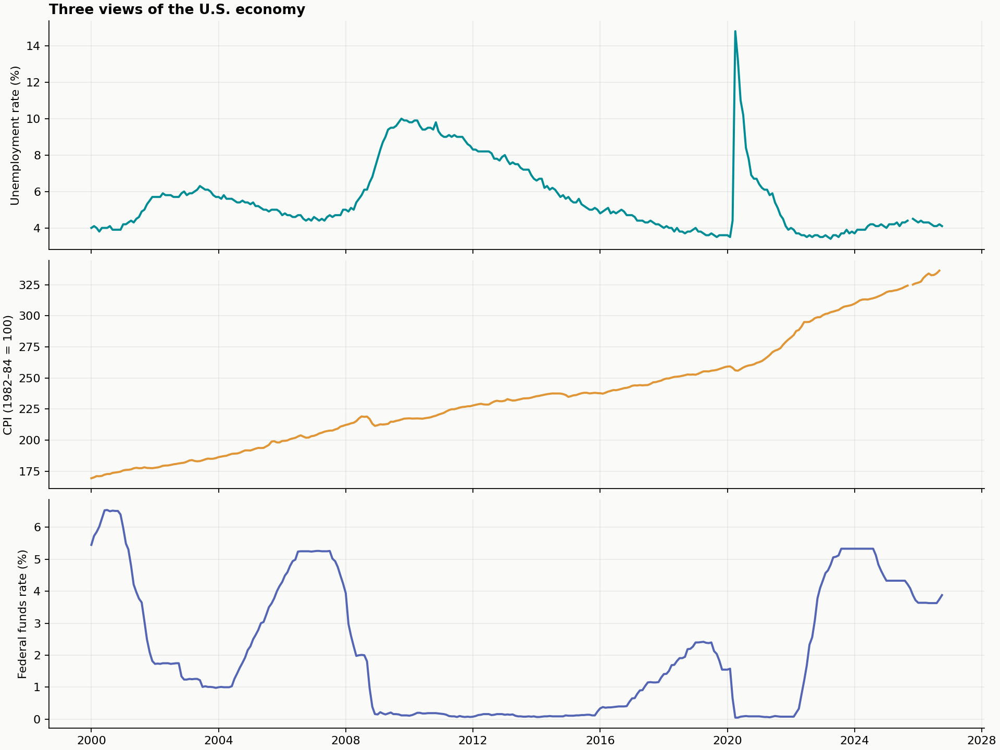
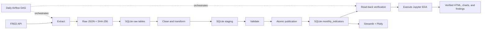

# U.S. Macroeconomic Data Pipeline & Dashboard

A Northwestern University **Topics in Data Engineering, Fall 2026** project: ingest FRED observations, retain auditable raw data, publish validated SQLite tables, orchestrate daily updates with Apache Airflow, analyze the economy in Jupyter, and explore it in an independent Streamlit + Plotly dashboard.



## Quick start with Docker

Prerequisites: Git, Docker Engine/Desktop with **Compose v2 or later**, internet access, and your own [FRED API key](https://fred.stlouisfed.org/docs/api/api_key.html). Recommended Docker VM resources: 4 CPUs, 8 GB RAM, and at least 10 GB free disk for images and builds. The upstream images support Apple Silicon and Linux.

```bash
git clone https://github.com/xingsun19/us-macroeconomic-pipeline-dashboard.git
cd us-macroeconomic-pipeline-dashboard
cp .env.example .env
# Edit .env: FRED_API_KEY=your_32_character_key
bash scripts/start.sh
```

The script configures host user IDs for bind mounts, builds the images, loads real data, and starts the stack. Initial downloads take several minutes. It never prints the API key.

- **Dashboard:** [http://localhost:8501](http://localhost:8501)
- **Airflow:** [http://localhost:8080](http://localhost:8080), username `admin`. Read its generated local password using `docker compose exec airflow cat /opt/airflow/state/passwords.json`.
- Check readiness using `docker compose ps`. The initial `pipeline` service exits with code 0; that is expected. The dashboard starts only after a successful load.
- The `us_macro_pipeline` DAG is enabled by default and runs daily at **18:00 UTC**. Each successful update automatically executes the EDA notebook and regenerates the HTML report, PNG charts, statistics, and findings. Keep the machine and Docker running for scheduled updates.

This is a **local demonstration deployment**. Ports bind to loopback; Airflow uses the development Simple Auth Manager, local PostgreSQL credentials, and a local JWT signing setting. Remote deployment needs separate authentication, TLS, private networking, and managed secrets. PostgreSQL stores **Airflow metadata only**; all FRED data are in SQLite. No paid service is required.

## Dashboard features

- Latest values with each series' own observation month and adjacent-month changes.
- Arbitrary date ranges within the available history and selectable original/derived indicators.
- Separate original-unit charts and standardized overlays; Plotly zoom, pan, reset, hover, and PNG export.
- Scatter plots with 0–24 month outcome lags and correlation heatmaps in levels or monthly changes.
- Downloadable CSV reflecting selected dates/indicators and including quality flags.
- Direct SQLite reads with a 60-second cache and a **Refresh database** button; no FRED requests or API key are needed by the dashboard.

Latest-value cards use the full dataset. Charts and downloads use the selected window. Date filters include observations whose month-start date is in the selection. Positive lag k pairs X at t with Y at t+k, keeping both months inside the window. Refreshing the dashboard does not itself fetch new FRED data.

## Architecture and repository



Actual DAG: `extract_api → store_raw → clean_transform → validate_quality → publish_database → verify_update → generate_analysis`. The CLI and DAG use the same data-stage functions. XCom carries only a pipeline identifier. Both SQLite audit records and Airflow record stage/task durations and outcomes.

The final task runs only after all six data stages succeed. It executes every notebook cell in an isolated, hash-locked Python environment inside the Airflow container, so notebook dependencies cannot alter Airflow's environment. A SQLite backup fixes the analysis to the exact published run. Outputs are generated in a temporary directory and validated before replacing the existing reports; a cell error or missing figure fails the Airflow task and preserves the previous report. Each file is replaced atomically and the provenance/checksum manifest is written last. Two retries and the task timeout apply to analysis too. A report error does not invalidate the successfully published data used by the dashboard.

## Where to see the automatically refreshed analysis

| Output | Local path |
|---|---|
| Interactive dashboard | `http://localhost:8501`; click **Refresh database** to read newly published data |
| Complete HTML analysis report | `reports/eda.html` (on macOS: `open reports/eda.html`) |
| Executed notebook | `notebooks/01_macroeconomic_eda.ipynb` |
| Four PNG figures | `reports/figures/` |
| Statistical tables, findings, and exported data | `reports/*.csv`, `reports/findings.md` |
| Report run, vintage, generation time, and artifact hashes | `reports/report_manifest.json` |

The reports and notebook directories are bind-mounted into Airflow, so results persist on the host and remain available after container restarts. No manual notebook command is needed for the daily schedule. To request the **complete** update immediately, trigger `us_macro_pipeline` in Airflow or use `docker compose exec airflow airflow dags trigger us_macro_pipeline`. A run is complete only when **generate_analysis** succeeds. The data-only `macro-pipeline update` CLI remains available for independent ingestion.

Automatic generation updates local files; it does not automatically commit reports to GitHub. The public repository shows the latest submitted snapshot.

For an existing installation, rebuild and restart Airflow after pulling this update: `docker compose up -d --build --no-deps airflow`. Keep its DAG enabled. The first complete run can be triggered with the command above.

```text
src/macro_pipeline/       API client, SQLite, transformations, pipeline, CLI, analysis
dags/                    Executable Airflow 3.1.8 TaskFlow DAG
dashboard/app.py         Independent Streamlit + Plotly application
notebooks/               Executed EDA notebook with findings
tests/                   Offline, integration, UI, and DAG tests
reports/                 Findings, statistics, figures, verification record
docs/                    Data dictionary and assignment mapping
scripts/                 Startup, notebook/DAG execution, secret scan
docker/                  Airflow image and official vendored constraints
compose.yaml             Complete local stack and optional test/notebook services
requirements.lock        Universal Python dependency lock with hashes
requirements-analysis.* Minimal, separately locked notebook execution runtime
.github/ci-template.yml  Ready-to-enable CI tests and Airflow graph checks
.env.example             Credential-free configuration template
data/                    Local SQLite and raw snapshots; ignored by Git
```

## Data model and quality policy

The analysis starts in January 2000. Ingestion includes 1999 as a twelve-month warm-up for inflation. Requests specify a common FRED vintage, support pagination, and retry transient failures with bounded timeouts. Error messages exclude credential-bearing request URLs and response bodies.

Each daily update re-fetches the small full history (about 1,000 source observations), capturing old revisions and new months. Raw snapshots are retained per run. A unique date key and atomic replacement prevent duplicate published months.

| SQLite table | Purpose |
|---|---|
| `pipeline_runs` | Vintage, status, raw checksum, validation report, completion time |
| `pipeline_steps` | Per-stage status and duration |
| `raw_payloads` | Original series metadata and observation JSON |
| `raw_observations` | Raw strings and FRED real-time fields, keyed by run/series/date |
| `staged_monthly` | Candidate data isolated by run ID |
| `monthly_indicators` | Validated data read by EDA and dashboard |
| `dataset_state` | Current published run and publication timestamp |

Checks cover all three series, month-start dates, continuous calendars, duplicates, finite plausible values, sufficient history, freshness (latest observation within 95 days of the vintage), quality flags, and derived identities. Conflicting duplicates, omitted calendar months, more than 5% explicit source missingness, stale series, or invalid transformations block publication.

**Official missing values are preserved.** FRED `.` becomes NULL with `source_missing`; absent trailing releases are `not_released`. Nothing is interpolated or forward-filled. October 2025 unemployment and CPI are missing due to the government shutdown, as documented by [BLS CPS](https://www.bls.gov/cps/methods/2025-federal-government-shutdown-impact-cps.htm) and [BLS CPI](https://www.bls.gov/cpi/additional-resources/2025-federal-government-shutdown-impact-cpi-faq.htm). Calculations using a missing denominator remain null.

A failed extraction, transformation, or validation leaves the last successful dataset intact. Publication is one transaction; WAL, busy timeouts, and snapshot reads support dashboard access during updates. Older runs cannot replace newer snapshots. Airflow allows one active run; avoid launching a manual CLI writer while a scheduled run publishes. Raw/staging history is retained for audit and grows over time. See [the data dictionary](docs/data_dictionary.md).

## EDA and testing

```bash
# Optional manual report rerun; the daily DAG already performs this step
docker compose run --rm --no-deps notebook python scripts/execute_notebook.py

# Interactive JupyterLab; use the generated token from the local logs
docker compose --profile tools up -d notebook
docker compose logs notebook
# Open http://localhost:8888 with that token

# Offline tests; no API requests or key required
docker compose run --rm --no-deps tests

# Airflow import and dependency graph
docker compose exec airflow pytest /opt/project/tests/test_dag.py -q

# Real seven-task smoke test, including report generation
# Pause scheduling and wait for active runs to finish before this isolated smoke test
docker compose exec airflow airflow dags pause us_macro_pipeline
docker compose exec airflow python /opt/project/scripts/test_dag_run.py
docker compose exec airflow airflow dags unpause us_macro_pipeline

# Trigger a real scheduler/executor run immediately
docker compose exec airflow airflow dags trigger us_macro_pipeline
```

The smoke test calls the live FRED API and skips no tasks. It disables retries only in its own process to fail promptly. Production tasks retain two retries, a two-minute delay, and ten-minute task timeouts; the DAG timeout is 45 minutes. The included CI template runs deterministic synthetic fixtures and separately checks the real DAG; fixtures are never used by production ingestion.

**Optional GitHub Actions activation:** the publishing credential currently lacks GitHub's `workflow` scope. The complete workflow is therefore shipped as `.github/ci-template.yml`, and remote CI has not run. After granting that permission, move it to `.github/workflows/ci.yml` and push. All required application, DAG, notebook, and browser checks were executed locally; the project does not depend on GitHub Actions to run.

The executed notebook contains descriptive statistics, trends, annual summaries/counts, level/change correlations, pair counts, subperiod comparisons, rolling correlations, lead–lag analysis, and computed findings. The executed `.ipynb`, PNG figures, CSV summaries, and [findings](reports/findings.md) are tracked. `reports/eda.html` is generated locally and ignored by Git.

## Native Python alternative

Python 3.11 is the reference runtime; the application is also tested locally on Python 3.13. Keep Airflow isolated in its container.

```bash
python3.11 -m venv .venv
source .venv/bin/activate
python -m pip install --require-hashes -r requirements.lock
python -m pip install --no-deps -e .
cp .env.example .env  # Skip if already configured; edit your own key
macro-pipeline update
macro-pipeline validate
python scripts/execute_notebook.py
streamlit run dashboard/app.py
```

Stop the Docker dashboard first if using the same port. Local tests: `pytest -m 'not airflow and not live'`. For offline Docker tests on a fresh clone, create `.env` from the example (an empty key is sufficient), build the image, and run the test command with `--no-deps`.

## Updates and historical reproduction

```bash
docker compose run --rm pipeline macro-pipeline update
docker compose run --rm --no-deps pipeline macro-pipeline validate
docker compose run --rm --no-deps pipeline macro-pipeline export --output /app/reports
docker compose run --rm --no-deps pipeline macro-pipeline analyze --output /app/reports
docker compose down  # Data and named volumes persist

# Reproduce the submitted vintage in a separate database
docker compose run --rm --no-deps \
  -e MACRO_DB_PATH=/app/data/vintage-2026-11-08.db \
  pipeline macro-pipeline update --as-of 2026-11-08
```

Point `MACRO_DB_PATH` at the separate database when analyzing that historical snapshot. A vintage snapshot is not a look-ahead-free real-time backtest. Do not set `MACRO_AS_OF` permanently for daily live updates.

## Results and assignment scope

The **2026-11-08 vintage** contains **322 monthly rows, 2000-01–2026-10**. Latest unemployment: **4.1%** (October 2026); CPI: **336.298** (September 2026); effective federal funds rate: **3.88%** (October 2026). October 2025 unemployment/CPI and unreleased October 2026 CPI are intentionally null.

Unemployment peaks at **14.8% in April 2020**. Seasonally adjusted CPI YoY inflation peaks at **8.98% in June 2022**. The unemployment–inflation Pearson correlation is **−0.437 in levels** and **−0.196 in monthly changes**. These descriptive associations are sensitive to transformations, autocorrelation, and regimes; they do not identify causation or forecast outcomes.

See [verification](reports/verification.md) and [assignment mapping](docs/requirements.md). The five technical requirements are implemented. PowerPoint is deferred at the user's request; team/API approval and classroom presentation remain human course responsibilities.

## Troubleshooting, security, and maintenance

- **API key:** edit `.env`; never commit it. Errors are sanitized. Do not share raw request URLs or unfiltered Airflow logs, which may contain generated login credentials.
- **Compose missing:** install Docker Desktop or the official plugin. Homebrew Docker/Colima users can install `docker-compose` and follow its plugin-directory instructions.
- **Permissions:** the startup script sets `LOCAL_UID`/`LOCAL_GID`. Update these in `.env` if moving the checkout to another host.
- **Airflow startup:** allow up to two minutes for migrations. Check `docker compose ps` and task logs.
- **Exit code 137 or builds running out of space:** check the Docker VM's memory and disk, not only the host's free resources. Allocate the recommended resources above. Colima users can stop the VM and restart it with `colima start --cpu 4 --memory 8 --disk 30`; restarting interrupts other containers on that VM.
- **Validation failure:** inspect SQLite run/step records and retained raw JSON. Fix the source/configuration issue and rerun; do not silently fill data or relax checks.
- **Old dashboard:** refresh its cache, check the vintage, and inspect the DAG schedule. Keep Docker running for updates.
- **Backups:** back up `data/` and the Airflow PostgreSQL volume. Use SQLite's backup API while writers are running instead of copying only the `.db` file and omitting its WAL.
- **Long-term reproduction:** Python dependencies are version/hash locked; Airflow constraints are vendored; Python/Airflow base images use digests. Archive Docker images, raw JSON, SQLite backups, and a Git release together. External APIs and registries cannot be guaranteed in five years. Regenerate the lock and rerun all tests after intentional dependency upgrades.

## Sources and license

Source data: BLS and the Federal Reserve via [FRED](https://fred.stlouisfed.org/). Implementation references: [FRED observations API](https://fred.stlouisfed.org/docs/api/fred/series_observations.html), [Airflow 3.1.8](https://airflow.apache.org/docs/apache-airflow/3.1.8/start.html), and [Streamlit AppTest](https://docs.streamlit.io/develop/api-reference/app-testing). Code is MIT licensed; source-data terms and attribution requirements still apply.
