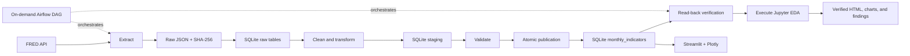

# Architecture and quality controls

Actual DAG: `extract_api → store_raw → clean_transform → validate_quality → publish_database → verify_update → generate_analysis`. The CLI and DAG use the same data-stage functions. XCom carries only a pipeline identifier. Both SQLite audit records and Airflow record stage/task durations and outcomes.

The final task runs only after all six data stages succeed. It executes every notebook cell in an isolated, hash-locked Python environment inside the Airflow container, so notebook dependencies cannot alter Airflow's environment. A SQLite backup fixes the analysis to the exact published run. Outputs are generated in a temporary directory and validated before replacing the existing reports; a cell error or missing figure fails the Airflow task and preserves the previous report. Each file is replaced atomically and the provenance/checksum manifest is written last. Two retries and the task timeout apply to analysis too. A report error does not invalidate the successfully published data used by the dashboard.

## Data model and quality policy

The analysis starts in January 2000. Ingestion includes 1999 as a twelve-month warm-up for inflation. Requests specify a common FRED vintage, support pagination, and retry transient failures with bounded timeouts. Error messages exclude credential-bearing request URLs and response bodies.

Each requested update re-fetches the small full history (about 1,000 source observations), capturing old revisions and new months. Raw snapshots are retained per run. A unique date key and atomic replacement prevent duplicate published months.

| SQLite table | Purpose |
|---|---|
| `pipeline_runs` | Vintage, status, raw checksum, validation report, completion time |
| `pipeline_steps` | Per-stage status and duration |
| `raw_payloads` | Original series metadata and observation JSON |
| `raw_observations` | Raw strings and FRED real-time fields, keyed by run/series/date |
| `staged_monthly` | Candidate data isolated by run ID |
| `monthly_indicators` | Validated data read by EDA and dashboard |
| `dataset_state` | Current published run and publication timestamp |

Checks cover all three series, month-start dates, continuous calendars, duplicates, finite plausible values, sufficient history, freshness (latest observation within 95 days of the vintage), quality flags, and derived identities. Conflicting duplicates, omitted calendar months, more than 5% explicit source missingness, stale series, or invalid transformations block publication.

**Official missing values are preserved.** FRED `.` becomes NULL with `source_missing`; absent trailing releases are `not_released`. Nothing is interpolated or forward-filled. October 2025 unemployment and CPI are missing due to the government shutdown, as documented by [BLS CPS](https://www.bls.gov/cps/methods/2025-federal-government-shutdown-impact-cps.htm) and [BLS CPI](https://www.bls.gov/cpi/additional-resources/2025-federal-government-shutdown-impact-cpi-faq.htm). Calculations using a missing denominator remain null.

A failed extraction, transformation, or validation leaves the last successful dataset intact. Publication is one transaction; WAL, busy timeouts, and snapshot reads support dashboard access during updates. Older runs cannot replace newer snapshots. The launcher prevents concurrent Run windows; avoid launching another CLI or Airflow writer during a run. Raw/staging history is retained for audit and grows over time. See [the data dictionary](data_dictionary.md).
